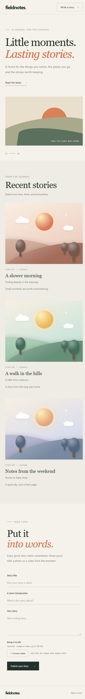

# Fieldnotes Blog

A simple blog application built with React, Spring Boot, and MySQL. Read and
publish stories, and optionally attach an image or video to a post.

GitHub repository: [sugandhaverma/blog](https://github.com/sugandhaverma/blog)



*The screenshot shows the mobile layout with example posts.*

## Features

- View and create posts in the React frontend.
- Upload an image or video with a post; files are stored locally by the backend.
- Show animated landscape illustrations for posts without media.
- Use REST endpoints for managing posts and creating or listing comments.

## Requirements

- Java 17 or newer.
- Node.js 18 or newer and npm.
- MySQL with a database named `myblog` and a user that can access it.

The Maven wrapper is included, so a separate Maven installation is not required.
Create the database if needed:

```sql
CREATE DATABASE IF NOT EXISTS myblog;
```

By default, the backend connects to `localhost:3306` using the MySQL username
`root`. Update [application.properties](src/main/resources/application.properties)
if your database host, port, or username differs.

## Run locally

Open two terminals. The following commands are for Windows Command Prompt.

### 1. Start the backend

From the project root, set `DB_PASSWORD` to your MySQL password and start Spring
Boot in the same terminal:

```cmd
cd /d E:\my_blog
set DB_PASSWORD=your_mysql_password
mvnw.cmd spring-boot:run
```

The API runs at `http://localhost:8081`. The application uses
`spring.jpa.hibernate.ddl-auto=update`, so Hibernate may update the database
schema on startup. Keep the terminal open while using the app.

### 2. Start the frontend

In the second terminal:

```cmd
cd /d E:\my_blog\frontend
npm install
npm run dev
```

Open the URL printed by Vite, normally `http://localhost:5173`. The development
server forwards `/api` and `/uploads` requests to the backend on port 8081.
If the frontend cannot load posts, check that the backend and MySQL are running.

For PowerShell, set the password with `$env:DB_PASSWORD = "your_mysql_password"`
before starting the backend. Paths in the examples can be changed to match your
local checkout.

## API overview

| Method | Endpoint | Purpose |
| --- | --- | --- |
| `GET` | `/api/posts` | List posts; accepts `pageNo`, `pageSize`, and `sorting`. |
| `POST` | `/api/posts` | Create a post with `title`, `description`, `content`, and optional `mediaUrl` and `mediaType`. |
| `GET` | `/api/posts/{id}` | Get a post by ID. |
| `PUT` | `/api/posts/{id}` | Update a post. |
| `DELETE` | `/api/posts/{id}` | Delete a post. |
| `GET` | `/api/posts/{postId}/comments` | List a post's comments. |
| `POST` | `/api/posts/{postId}/comments` | Create a comment using `name`, `email`, and `body`. |
| `POST` | `/api/uploads` | Upload a file as multipart form data in the `file` field. |

Uploaded files are stored in the repository's `uploads` directory by default;
set the `UPLOAD_DIR` environment variable to use another directory. JPEG, PNG,
GIF, WebP, MP4, WebM, and MOV are accepted, with a 100 MB file limit.

## Tests and build

With `DB_PASSWORD` set and MySQL running:

```cmd
cd /d E:\my_blog
mvnw.cmd test
```

To build the frontend:

```cmd
cd /d E:\my_blog\frontend
npm run build
```

## Security note

The current backend permits all requests and has CSRF protection disabled.
It is intended for local development; configure authentication, authorization,
and upload protections before exposing it publicly.
